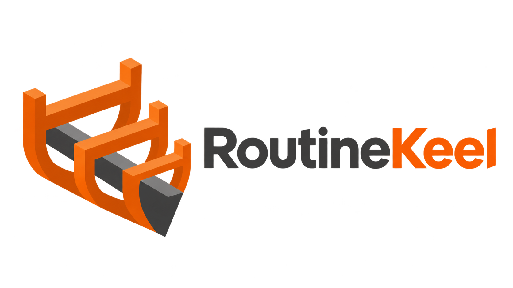

<p align="center">
  
</p>

# RoutineKeel

**讓重複的工作有固定步驟，讓每次執行都有跡可循。**

RoutineKeel 是一套可以安裝一次、搭配多個工作流程使用的工具。它先幫你準備電腦需要的環境，再按照選定流程執行任務，顯示進度、保存紀錄，並把結果放在固定位置。

名字中的 **Routine** 是日常反覆發生的任務，**Keel** 是讓船身穩定的龍骨。我們希望它像船底的支撐：平常不必一直注意，卻能讓工作穩定前進。

對外專案與根資料夾名稱為 **RoutineKeel**；內部共用底座仍叫 **flow_base**。原有流程名稱、設定與程式套件名稱繼續沿用。

## 它能幫你做什麼？

假設你有一支上課影片，希望整理成字幕。你不需要自己依序找工具抽音訊、辨識每段語音，再拼回時間軸。選擇「課程影片產生字幕」流程後，程式會依序完成這些工作，並提供可閱讀、可聽原音的確認頁面。

它適合需要把固定工作分享給學員、同事，或想在不同電腦上重複使用同一套流程的人。一般使用者不需要閱讀原始碼；想擴充的人可以只開發新流程，繼續共用既有底座。

| 你在意的事情 | RoutineKeel 的做法 |
| --- | --- |
| 每台電腦環境不同 | 檢查系統、運算資源與環境；流程依檢查結果選擇執行方式 |
| 不想手動安裝一堆東西 | 提供 Windows、macOS、Linux 啟動入口；首次使用才準備所需工具 |
| 不知道程式有沒有在工作 | 流程開始、節點切換、完成或失敗都有醒目訊息；有可計算總量時顯示進度 |
| 失敗後不想全部重來 | 保存執行紀錄與已驗證的結果；符合條件時重用或透過流程提供的恢復功能繼續 |
| 擔心 AI 花費不透明 | 分開記錄流程 API 用量與可取得的 Codex Session 收據，未知值不冒充零 |
| 做完後找不到檔案 | 結果放在該流程的 `outputs/`；程式與自己的成果分開 |

## 第一次使用

**建議直接下載 [RoutineKeel 一鍵啟動包](downloads/RoutineKeel-0.2.10.zip)。** 開啟檔案頁後按下載按鈕，完整解壓縮，就會得到名為 `RoutineKeel` 的資料夾。不要直接在 ZIP 壓縮檔內啟動。

目前儲存庫是私人專案，GitHub 下載連結需要有存取權限；要分享給學員，可以直接交付下載好的 ZIP，不需要把私人儲存庫公開。

1. 進入 `RoutineKeel`，再進入你要使用的流程，例如 **課程影片產生字幕**。
2. 依作業系統開啟下表的入口。
3. 首次啟動等待環境與模型準備完成。這個階段需要網路，下載時間取決於網路與電腦。
4. 依畫面提示指定影片，確認執行計畫，再開始工作。
5. 完成後開啟程式指出的字幕確認頁，聽取疑義片段並校對。

| 電腦 | 啟動方式 |
| --- | --- |
| Windows | 雙擊流程資料夾內的 `run_app.bat` |
| macOS | 開啟 `run_app.command`；首次可能需要依系統提示允許執行 |
| Linux | 在流程資料夾執行 `sh run_app.sh` |

入口會在必要時準備 uv 與 Python，不需要先手動建立 `.venv`。macOS／Linux 在尚無 uv 時需要系統提供 curl 或 wget，以及 unzip；組織管理政策仍可能限制安裝。

也可以開啟 `flow_base` 內的入口，從共用入口選擇不同流程。自然語言入口支援已宣告的常用說法，不保證能理解任何自由描述；在 Codex 中使用時，Agent 應先讀取目標流程的 `AGENTS.md`，再透過底座執行。

若畫面停在等待輸入，可依序輸入：

```text
/input D:\課程\上課影片.mp4
/run
```

先看計畫中的來源、模型、裝置與輸出位置是否符合本次任務。大模型不代表每台電腦都能很快完成；沒有可用的 CUDA 後端時可能使用 CPU，實際選擇會顯示在紀錄中。

## 目前提供的流程

### 課程影片產生字幕

**版本 0.3.4，預設 faster-whisper large-v3。**

流程會抽取音訊、找出有語音的區段、逐段辨識並保留時間位置，接著整理字幕、檢查品質，產生 SRT／VTT 與人工確認資料。預設辨識提示至少包含「繁體中文」；已知的課程主題與專有名詞可以補入提示，協助辨識。

主要交付包含：

- **網頁確認頁**：看字幕、看疑義，並聽對應原音。
- **中文確認表與校對稿**：方便填答、校訂與保存。
- **字幕與確認資料 ZIP**：方便整包分享；請完整解壓以保留檔案間的連結。
- **SRT／VTT**：可供支援字幕的播放或剪輯工具使用，仍應依審閱狀態決定是否正式採用。

**程式跑完，不等於字幕已經通過真人驗收。** `REVIEW_REQUIRED` 表示仍待人工確認；`FAIL` 表示有必須處理的問題。不要只看到檔案存在，就當成最終定稿。

目前這個字幕流程**不會自動呼叫外部 LLM API 校訂**。辨識在本機執行；首次安裝與取得模型仍會連線。Codex 對話本身的模型耗用是另一個範圍，不代表整段操作完全沒有 token 成本。

詳細操作見 [字幕流程說明](課程影片產生字幕/README.md)。

### 檔案複製範例

**版本 0.2.2。** 用簡單的檔案工作示範「同一個底座支援另一個獨立流程」。適合先確認啟動與輸出機制，不需要先下載語音模型。

## 資料夾怎麼看？

下載包的最外層叫 **RoutineKeel**。GitHub 另外保留開發與維護資料，一般使用者只需要看 README、底座與想用的流程。

| 路徑 | 放什麼 | 一般使用者需要改嗎？ |
| --- | --- | --- |
| `flow_base/` | 共用底座、安裝與啟動入口 | 更新底座時才更換程式檔案 |
| `課程影片產生字幕/` | 字幕流程、設定範例與入口 | 需要調整流程設定時才修改 |
| `檔案複製範例/` | 第二個流程範例 | 可選用 |
| `assets/` | RoutineKeel Logo 等品牌素材 | 不需要 |
| `docs/` | 架構、目錄與維護說明 | 想深入了解時閱讀 |
| `source/` | 底座、流程、測試與打包工具的完整原始碼 | 只有開發時需要 |
| `downloads/` | 已整理好的學員啟動包與檔案校驗值 | 下載使用即可 |
| `.venv/` | 執行時建立的共用 Python 環境 | 不手動編輯、不放入 Git |
| `share_states/` | 執行狀態、快取、模型等共用資源 | 不隨意刪除、不放入 Git |
| `share_logs/` | 安裝與執行紀錄 | 出問題時查看，不放入 Git |
| `各流程/outputs/` | 你的實際成果 | 保留、備份；不隨程式上傳 |

最後四類會在使用時建立，**不預先打包，也不是缺少檔案**。流程輸出內的 `docs/` 是該次工作的文件，`artifacts/` 是實際成果；只有需要交付腳本時才建立 `scripts/`。

## 怎麼知道真的走了工作流？

畫面會依序出現 **WORKFLOW START、STEP START、STEP DONE、WORKFLOW END**；失敗或中斷則會顯示停止訊息。每次執行都有自己的 `run_id`，可以對照本次輸出與日誌。

長任務的進度只使用程式回報的實際數量；未知總量時會顯示活動與耗時，不捏造百分比。若在 Codex 內操作，工具輸出可能被折疊，因此 Agent 指引也要求將主要狀態轉述到對話正文。終端訊息另保存為 `console.log`，最新階段保存為 `live_status.md`。

## Token 統計代表什麼？

結束時分開顯示「流程直接呼叫 API 的用量」與「Codex 對話用量」。Codex 用量需要明確綁定目前 Session 的本機紀錄，或由宿主轉送用量通知；沒有可讀來源時就顯示無法取得。

同一段對話的累計值不等於這次工作新增的量，因此也會顯示起訖收據差值。已快取輸入包含在輸入總量中，推理輸出包含在輸出中，不重複加總。結束後才產生的回覆尚未計入；「目前沒收到新收據」也不等於整輪對話免費。

綁定方式與限制見 [底座完整說明](flow_base/README.md)。

## 更新、搬移與分享

- **更新底座**：先結束執行中的工作，再更換 `flow_base` 的程式檔案。保留狀態、日誌、流程及自己的成果。
- **更新流程**：更換該流程包的程式檔案，保留自己的設定與 `outputs/`。不要同時留下兩份相同識別碼的流程副本。
- **換電腦**：可攜帶底座與流程包，在新電腦重新建立環境；`.venv` 不應當成跨作業系統的可攜程式。大型資源可使用底座提供的資源匯出／匯入功能，設定與成果另行備份。
- **分享給學員**：交付乾淨的啟動包或「一份底座＋需要的流程」。不要把自己的影片、逐字稿、Session 紀錄、API 金鑰或個人快取一起分享。

目前版本組合為 **flow_base 0.2.10＋字幕流程 0.3.4＋複製範例 0.2.2**。既有完整回歸測試為 **221 項通過**；已驗證 Linux 與 Linux 上的 PowerShell 測試入口，Windows／macOS 真機雙擊與各電腦 CUDA 組合仍需實機確認。測試通過不等於任何錄音都能自動產生無誤字幕。

## 想維護或增加流程？

請先看 [目錄與協作方式](docs/structure.md) 和 [維護與打包](docs/maintenance.md)。底座負責共用能力，流程負責自己的領域規則；新增一個流程，不應要求把其模型、處理邏輯或驗收規則塞進底座。

程式碼沿用原套件的 MIT 授權，見 [LICENSE](LICENSE)。Logo 保留使用者提供的原始 PNG，素材說明見 [assets/README.md](assets/README.md)。
