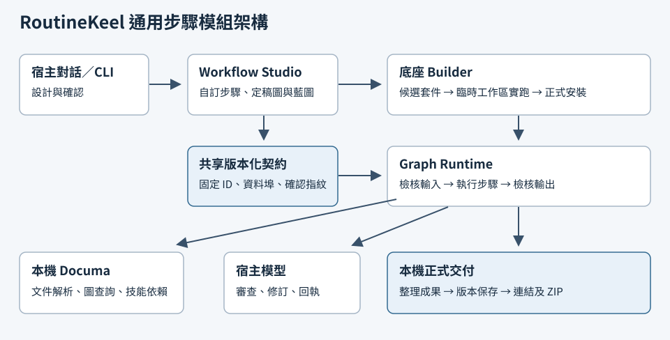
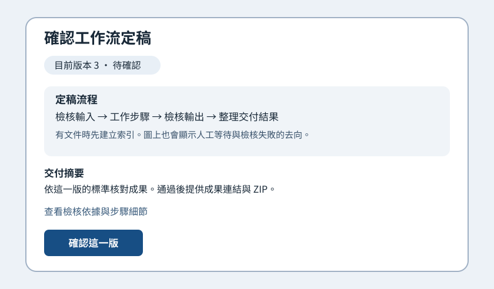

# 規格整理 v 1.2.0

## 技術規格文件

**RoutineKeel 底座通用步驟與 Documa 整合** · 2026-11-24 · 藍圖 v2、通用步驟契約版本 1

### 背景、假設與範圍

Workflow Studio 保存業務設計、設計決策和確認證據。Flow Base 執行輸入檢核、文件索引、輸出檢核與成果交付，並提供可供個別工作流引用的勾稽、文件查詢、技能載入與模型檢核步驟。過去合稱的「檢核與交付輸出」拆為兩個有各自成功條件的步驟。

本規格以已討論的設計及目前工作樹為基線。通用步驟版本 1 使用現行 Graph Runtime、Studio、CLI 與 MCP stdio。保持既有工作流識別碼、v1/v2 藍圖入口、Run、Artifact 與本機 SQLite 相容性。現有桌面對話即為審閱介面。Documa 由宿主提供本機執行檔與受信技能目錄。正式模型呼叫依宿主能力、預算及授權執行。正式發布、私有環境更新與付費或外傳各依原授權程序。

### 使用角色與 G3M

| 項目 | 定義 |
| --- | --- |
| 設計者 | 確認業務步驟、資料來源、勾稽基準、模型評分標準及失敗去向。 |
| 執行者／校閱者 | 遞交當次資料，處理待辦，檢視證據並取得具名成果。 |
| 維護者／QA | 維護共享契約與宿主綁定，重跑驗收並核對發行與回退證據。 |
| Goal 目標 | 可重用的底座步驟在定稿圖、藍圖、實際執行與交付之間保持一致。 |
| Methods 方法 | 共用固定 ID、版本及資料埠，分開保存設計確認、候選驗收與正式交付的證據。 |
| Metrics 衡量 | 每份新定稿有三個固定節點。文件情境才走索引分支。相同勾稽規則連跑兩次時只有一次建立計畫。交付 ZIP 的檔案可逐一核對。所有必要驗收案例均須通過。 |
| Milestones 里程碑 | 先打通定稿至交付，再驗證勾稽、Documa 和模型回修，最後重跑相容性與隔離安裝。 |

### 系統與專案目錄



```text
RoutineKeel/
├─ flow_base/
│  ├─ components/workflow_contracts/  共享能力、資料埠、定稿驗證與 Documa 介面
│  ├─ src/flow_base/graph/          檢核、勾稽、文件工作與模型回執
│  ├─ src/flow_base/blueprints/     建置、候選試做、安裝與 v1 技能相容
│  ├─ src/flow_base/outputs.py      成果連結、索引與 ZIP 組裝
│  ├─ share_states/                工作、素材引用、快取及 Run 證據
│  └─ share_logs/                  執行事件與診斷
├─ workflow_studio/                設計對話、來源預覽、定稿與匯出
├─ workflows/                      業務設定及正式本機成果
├─ tests/                          固定案例、假回執、故障與整合測試
└─ docs/specs/base-steps/            規格、白話指南及分階段交接
```

能力 ID 採 `base.<領域>.<動作>`。共享契約集中於 `routinekeel_contracts/base_steps.py`，宿主不得從顯示名稱推斷能力 ID。文件與技能整合共用 `routinekeel_contracts/documa.py`。既有 `flow_base` 的原子交付與版本復原保有正式成果的權威紀錄。

### 核心流程與功能規則

1. **初稿**顯示 Studio 設計的自訂步驟、依賴與分支，並從 `draft_design.base_step_catalog` 提供可引用的底座能力。設計者指定具名輸入輸出、檢核依據、可容許偏差、人工等待、失敗及復原路徑。有可互證資料的報表流程納入勾稽；資料或規則未明定時，先取得合理的比對基準。
2. **定稿**顯示最外層固定的「檢核輸入」「檢核輸出」「整理交付結果」，並標示文件索引條件分支。輸入檢核連至各無前置依賴的最外層節點，具名輸出共同匯入輸出檢核。可選底座步驟顯示能力名稱與實際位置。子流程由父節點展開，沿用其資料與依賴關係。
3. **確認與試做**保存 `quality_contract.base_steps_version`、`design_review.base_steps`、`final_diagram` 與 `review_hash`。使用者實際回覆須匹配定稿 ID、版本和指紋。匯出後，底座依既有 Builder 安裝流程建立候選套件，載入臨時工作區執行驗收案例。所有必要契約驗證、試做收據與安裝前重驗通過，才可依既有授權安裝。工具或案例缺口由藍圖補強流程處理。
4. **正式執行**底座先查核必要欄位、未知欄位、資料型別、檔案引用與可讀性。特殊文件交給 Documa 建索引。自訂節點依圖執行，途中可執行勾稽、模型檢核或等候人審。底座收束具名成果，執行品質契約並記錄交付資格。
5. **正式交付**品質合格後，底座在 staging 組裝成果、連結、索引與 ZIP，驗證完整性後提交正式交付版本和 Run 紀錄。未具交付資格時保存可用預覽和證據，正式結果由既有品質決策及授權流程處理。

### 通用步驟輸入輸出契約

`object` 為具名欄位物件，`json` 容許任何合法 JSON 值。底座邊界在圖上是執行階段標示，藍圖自訂 `nodes` 由 Studio 保存。可選步驟是可由圖引用的 `task`，須符合能力版本、資料埠、參數及權限宣告。

| 中文名稱與能力 ID | 類別及輸入／參數 | 輸出與接續 |
| --- | --- | --- |
| 檢核輸入 `base.input.check` | 固定。`inputs: object`、`ports: object` | `inputs: object`、`inputs_hash: string`。輸入失敗即阻擋進入業務步驟。 |
| 建立文件索引 `base.document.index` | 條件。`documents: array` 為已驗證的文件素材引用 | `document_indexes: object`。有特殊文件才啟動 Documa，無文件時索引值為空物件。 |
| 檢核輸出 `base.output.check` | 固定。`outputs: object`、`quality_contract: object` | `assessment_id`、`result_status`、`delivery_status` 皆為 `string`。評估具名成果、檔案引用與品質規則。 |
| 整理交付結果 `base.delivery.prepare` | 固定。`outputs: object`、`assessment_id: string`。執行條件為交付合格 | `links`、`link_index`、`archive`、`manifest` 皆為相對路徑 `string`。組裝驗證通過後，正式提交持久版本。 |
| 擬定勾稽計畫 `base.reconciliation.plan` | 選用。無當次資料埠。`parameters.rules` 定義規則 | `plan: object`，含 `version`、`sha256`、`spec`。同能力、版本及正規化規則，在同一底座快取有效時重用。 |
| 執行勾稽 `base.reconciliation.run` | 選用。`plan: object`、`left: json`、`right: json` | `matched: boolean`、`report: object`。依當次資料比對，報告逐規則回傳 `matched`、`mismatched` 或 `invalid_input`，無效計畫終止該步。 |
| 查詢文件索引 `base.document.search` | 選用。`indexes: object`、`query: string`。可選 `route` | `matches: array`，包含文件來源、區塊識別、摘錄與 Documa 圖路徑。有效查詢無命中時回傳無候選的結果。 |
| 載入技能 `base.skill.load` | 選用。`task: string`，可選 `skill_names`、`max_tokens` | `bundle: object`，保留 Documa 載入狀態、技能、依賴、來源、預算與下一步資訊。 |
| 模型審查 `base.model.judge` | 選用。`candidate: json`、`rubric: object` | `verdict: object` 須含 `passed: boolean`、`rationale: string`、`findings: array`。供分支及人工判讀。 |
| 批評者 `base.model.critic` | 選用。`candidate: json`、`rubric: object` | `critique: object` 採相同審查欄位，未通過須有具體待修項。 |
| 修訂者 `base.model.reviser` | 選用。`candidate: json`、`critique: object` 須對應同一原成果 | `candidate: json`。批評通過直接轉送，未通過才呼叫修訂模型，並維持輸出根資料型態。多輪須用 `repeat_until` 宣告上限和失敗去向。 |

### 勾稽、Documa 與模型的執行細則

- **勾稽計畫** `rules[].id` 唯一。`left`、`right` 採 JSON Pointer，空字串指向整份值。`operation` 為 `equals`、`count`、`sum` 或 `keyed`。總和與逐鍵比對可指定 `left_field`、`right_field`，逐鍵須給 `left_key`、`right_key`。容差以非負十進位字串表示。計畫快取經指紋查核及鎖保護，變更規則或版本時重新建立。當次資料缺欄、重鍵或數值無效產生 `invalid_input`。工作流設計須明定差異後續處理，必要時以 `matched` 阻擋正式交付。
- **文件** Studio 附件預覽、來源匯入後查詢、Runtime 的特殊文件解析及查詢均使用 Documa。支援範圍依整合所列 PDF、Office、HTML、郵件及 Notebook 格式與本機解析器。索引以驗證後素材、Documa 版本與執行檔指紋重用，失效時重建。`document_indexes` 以素材引用為鍵，包含 `ir`、`index`、`document_id`、`parser`、版本、區塊數及關係數。若下游使用此派生值，最外層藍圖宣告 `document_indexes: object` 後，以 `input://document_indexes` 綁定。執行者直接提交同名欄位須被拒絕。圖查詢支援 `auto`、`lexical-first`、`graph-first`、`overview`。
- **技能** Studio 與 Runtime 使用 Documa graph loader。`ROUTINEKEEL_DOCUMA` 指向受信的本機執行檔，或沿用本機可發現的 `documa`。`ROUTINEKEEL_DOCUMA_SKILL_STORE` 指向宿主管理的受信技能目錄。缺少目錄或遇 `needs_narrowing` 時呈現原因及可用候選。重新建置附技能的 v1 藍圖時，以其已確認的附件及依賴在暫存目錄交給同一 loader。既有已安裝方案依原封裝執行。
- **模型** 使用者可見文字一律 Streaming。模型呼叫需由宿主綁定同名能力及核定預算。真實回執須對應本次請求、完整串流指紋、用量及權限。模型結論供業務判斷分支使用，外部副作用與真人核准依各自的授權契約。規則、文件與技能文字僅提供資料或指引。
- **交付** 本機正式成果提供 `report.json`、`deliverables.json`、版本清單 `delivery-manifest.json` 及 `docs/run-summary.md`。`result_delivery` 引用 `artifacts/result-links.md`、`artifacts/result-links.json` 與 `artifacts/delivery.zip`。ZIP 包含本次具名輸出、對應素材與成果連結，條目使用相對路徑，提交前驗證 ZIP 及正式版本的完整性。

### 任務模型與資訊分類

| 優先級 | 任務 | 呈現時機 |
| --- | --- | --- |
| 唯一主目標 | 確認目前這一版設計及交付標準 | 定稿審閱的主操作。 |
| 次目標 | 修正設計、看執行狀態或下載成果 | 依目前階段顯示其中一個主要動作。 |
| 低頻目標 | 查能力契約、來源索引、差異、模型依據 | 使用者要求細節或交付評估需要證據時顯示。 |
| 罕見目標 | 重驗、回退、查歷史收據 | 有失敗、版本衝突或使用者主動要求時開啟。 |

### 狀態與資訊架構

| 設計／執行狀態 | 進入與離開條件 | 必顯資訊、延後資訊及主要操作 |
| --- | --- | --- |
| 尚未設計 | 尚無草稿，存入初稿後離開 | 目前工作目標。尚無詳細契約。主操作為開始設計。 |
| 初稿 `design_review_required` | 已保存草稿。完成設計欄位並通過歸檔檢查後進入定稿 | 業務圖、未決問題。完整底座目錄按需查看。主操作為補齊或產生定稿。 |
| 待確認 `ready_for_confirmation` | 定稿含當前版本及指紋。確認後匯出，修正時回到初稿 | 完整定稿圖、變更摘要及應確認的資料。原始歷史延後。主操作為確認這一版。 |
| 已匯出／候選驗收 | 使用者已確認並匯出，底座驗收通過後才進入安裝 | 藍圖版本、候選資格與缺口摘要。技術證據按需展開。主操作依序為試做與確認安裝。 |
| 執行／等候 | 正式 Run 已啟動。人審、授權或工具回執可使流程等候 | 目前階段、需處理事項及合法選項。主操作為處理待辦。自動處理期間顯示實際進度。 |
| 暫緩交付／失敗 | 品質不合格、必要檢核失敗、取消或組裝失敗 | 失敗階段、已保留的預覽與可恢復條件。主操作為查看原因或按契約重試。 |
| 已交付 | 正式成果已驗證並提交 | 具名成果連結與 ZIP。版本與收據按需查看。主操作為開啟成果。 |

**Content audit 與揭露策略**

| 內容 | 分類及頻率 | 首屏／階段 | 延後原因、觸發與容器 |
| --- | --- | --- | --- |
| 本版流程與確認動作 | `action-critical` · `must-see-now` · 高 | 是，定稿 | 即時顯示於當前對話與確認區，全版定稿可直接讀取。 |
| 目前狀態與接續動作 | `status-feedback` · `next-step-only` · 高 | 是，當下階段 | 後續動作等目前條件成立，顯示在行內狀態與操作區。 |
| 具名成果與輸出 ZIP | `decision-supporting` · `next-step-only` · 高 | 是，交付 | 完成交付後才產生正式連結，顯示在成果區。 |
| 錯誤碼、預覽及回復資訊 | `exception-handling` · `error-only` · 低 | 是，對應事件 | 平常收起。發生例外時在錯誤通知及證據連結顯示。 |
| 完整能力目錄、規則明細、文件索引 | `reference` · `on-demand-reference` · 中 | 否 | 回答設計或查證問題時才展開，在對話細節區或來源視圖顯示。 |
| 回執、指紋、歷史版本及內部診斷 | `audit/history` · `keep-off-first-viewport` · 低 | 否 | 使用者檢查驗收或追錯時開啟既有歷史／診斷入口。 |

### 對話介面與事件



沿用宿主控制項與版面。示意語言是淺色、專注於操作。白色承載對話、淡灰區分摘要、深色確保文字清楚，藍色標出本階段唯一主要動作。狀態用文字明示。每輪優先呈現主要操作、狀態、次要摘要。設計圖、待辦條件及正式成果在各自階段展開。縮放遵守原始寬高比，附件預覽缺失時顯示來源所在位置或限制。這兩張 SVG 用於規格說明。

離開介面後以原專案及版本續編。以現有新建專案入口開始新工作流，原專案可封存並回查。重試針對受影響的工作、節點或交付階段，不自動重複外部操作。可追蹤提交草稿、定稿、確認、候選驗收、輸入檢核、`documents_indexed`、等待、收取回執、品質結果及交付事件。事件以專案／版本／Run 關聯與指紋定位，常規診斷摘要僅保留必要資訊。

### 資料、持久化及更新與移除

| 物件 | 建立與持久化 | 修訂或移除方式 |
| --- | --- | --- |
| 專案、初稿及定稿 | Studio 保存在既有專案狀態。定稿保存規則清冊、依賴、圖及確認指紋 | 以預期修訂版更新初稿，產生新版定稿。封存應保留舊指紋與確認證據。 |
| 文件來源與索引 | 以內容指紋保存來源版本、預覽及索引。Runtime 以 `document_indexes` 保存引用 | 來源變更或解析器版本變更時重建。移除來源採來源既有封存語意，留存舊版證據所需引用。 |
| 技能載入包 | 由受信目錄及執行時任務取得，保存來源及預算證據。藍圖附件保存版本和內容 | 改用技能或版本時重新載入與定稿。從新版設計移除引用後，既有執行證據仍可查。 |
| 勾稽計畫及報告 | 計畫由底座版本和規則指紋定位。報告跟隨當次 Run | 新規則建立新計畫。已批准執行與結論以原指紋追查。失效快取可依本機維護流程重建。 |
| 節點結果、回執與正式交付 | Graph Session 保存檢查點、品質評估與外部回執。正式交付另存版本及檔案雜湊 | 改用新 Run 或按既有品質流程產生新版本。回退依交付流程切換已驗證版本，歷史留存依工作區保留政策。 |

### 入口及可觀測性

| 介面／事件 | 對應行為 |
| --- | --- |
| Studio 草稿、定稿與匯出 | MCP `studio_preview_blueprint` → `studio_finalize_workflow_design` → `studio_export_blueprint`。CLI `interview prepare_blueprint`、`interview finalize_workflow_design`、`interview export_blueprint`。匯出提交原定稿確認回覆及指紋。 |
| Studio 文件與技能 | MCP `studio_search_document` 接受來源 ID、相對檔名、查詢及可選版本和路徑；`studio_load_skills` 接受任務及可選技能與預算。CLI 為 `interview search_document`、`interview load_skills`。 |
| 執行、等待與品質回查 | 既有 CLI、MCP stdio 與 `WorkflowService` 入口。`blueprint_task` 查詢與續做、`workflow_quality` 提供具有版本的評估，Run 成果入口提供持久交付。 |
| 通知與背景行為 | 既有 Worker 依明確提交的工作執行，宿主依狀態及事件呈現待辦、失敗或完成。依既有 Run ID、請求去重及冪等規則續做。Documa 子程序具執行時間限制，失敗可排缺後重試。取消沿用底座 Run 流程。 |

維持本機、模組化及無常駐服務架構。覆蓋並行、重試、舊工作區、資料不完整、檔案拒絕、空工作流輸入、跨環境能力及交付階段中斷。原始路徑、個資、模型提示或憑證不得進入一般錯誤摘要。模型回執不可用時呈現待核對狀態，避免重複扣費或重複外部操作。

### 錯誤、例外與復原

| 情境 | 行為與建議提示 |
| --- | --- |
| 錯誤資料埠、路徑越界、素材遺失或指紋異常 | 停在檢核輸入，顯示「請核對輸入欄位與檔案後重試」。不得將該次資料傳給下游。 |
| Documa 缺失、解析器失效或來源版本改變 | 顯示原階段與 Documa 診斷。補齊執行檔或解析器後重試，來源變更時重建索引。明確揭露可用預覽。 |
| 勾稽有差異或輸入不符 | 保留規則結果，工作流按品質契約阻擋、分支或登記待修。未批准的偏差不得取得合格結果。 |
| 合約或確認指紋變更 | 停在定稿或匯入驗證，提示「請核對目前版本後重新確認」。禁止以舊回覆匯出新內容。 |
| 技能需縮小選擇、回執不完整、預算耗盡或人審拒絕 | 依真實狀態提供必要的補件、選擇或停止原因。未授權的副作用留待核准，模型回執不明先查核。 |
| 檢核或交付組裝失敗 | 保存可用預覽和診斷。ZIP／清單未通過完整性驗證時維持既有正式指標指向已驗證交付，按既有重試／復原入口處理。 |

### 驗收條件、測試與核對證據

| 編號 | Given／When／Then 驗收 | 可追溯驗證 |
| --- | --- | --- |
| RK-BS-01 | 有分支、具名輸出與人工節點。定稿時呈現三個固定節點、正確條件邊及每個選用底座 ID。修改圖、規則或指紋後，舊確認被拒絕。 | `tests/test_studio_design_contract.py`、`tests/test_graph_builder.py`。 |
| RK-BS-02 | 有正式驗收案例。候選套件必須在臨時工作區執行，未具驗收收據或安裝前重驗失敗時不得正式安裝。 | `tests/test_graph_builder.py`、`tests/test_blueprint_completion.py`。 |
| RK-BS-03 | 以同一勾稽計畫連跑兩次並修改第二份資料。第二次重用計畫且產出新的差異結果。逐鍵驗證重鍵、缺欄與兩側缺項。 | `tests/test_base_steps.py`。逐鍵及容差案例須有可重跑的固定資料。 |
| RK-BS-04 | 匯入 PDF 與 DOCX，建立索引後查到對應區塊，重複文件重用索引，偽造派生欄位被拒絕。使用受信技能目錄時依賴可追溯，缺少目錄時顯示對應狀態。 | `tests/test_base_steps.py`。真實 Documa 0.9.0。其他格式依實際 provider 分別驗收。 |
| RK-BS-05 | 模型批評通過時跳過修訂，未通過時使用同一原成果及批評內容修訂。錯誤輸出、截斷串流、超額或回執不明均不能算成功。 | `tests/test_base_steps.py`、`tests/test_graph_review_external.py`、`tests/test_graph_iterations.py`。正式宿主模型品質另用已授權案例驗收。 |
| RK-BS-06 | 交付資格成立時，解壓 ZIP 可定位所有本次成果並比對檔案清單。模擬 staging 中斷或品質暫緩時，上一版正式成果仍可核對。 | `tests/test_base_steps.py`、`tests/test_atomic_delivery.py`、`tests/test_mcp_stdio.py`。 |
| RK-BS-07 | 在兩個隔離 Python 環境裝入 Studio／Flow Base 與同版契約 wheel，兩者能載入能力目錄。保留 v1、舊 v2、CLI、MCP、Pattern 合成與升級行為。 | 新版 wheel 驗證、`tests/test_blueprint_install.py`、`tests/studio/test_pattern_composition.py`、`tests/studio/test_pattern_evolution.py`。 |

前輪留存 JUnit 記錄通用步驟與定稿 10 項、MCP／交付 51 項、Studio 相關回歸 42 項均通過。Studio 全量首輪為 564 通過、2 項定稿不一致；兩項在固定程式版本重跑通過。前輪另實測兩套隔離 wheel 的契約載入與 Documa 子程序。這些是既有驗證紀錄，本次規格交付檢查文件結構、連結及白話用字。模型採測試回執，正式模型結果及非 PDF／DOCX 的解析品質依其環境分別驗收。[專案交接與歷史](../../../DEVNOTE.md)

本輪 devloop 的最終快照、逐階段證據與回退方式見 [實測紀錄](verification.md)。最終實測同時核對候選封包、兩個隔離 wheel、CLI／MCP 以及 Windows 與 Linux 的平台互補案例。

### 相容、觀察項目及回滾

維持舊藍圖的既有執行行為，新定稿用版本 1 通用契約。Studio 與底座須使用同版共享契約，版本不一致時重新確認環境。核准與安裝政策依 [Graph v2](../blueprint-graph-v2.md)、[藍圖補強](../blueprint-completion.md) 及 [藍圖安裝](../../../flow_base/docs/blueprint-install.md)。本變更沿用既有資料庫格式。若需回退，留存現有資料與新藍圖，按套件版本及正式成果版本分別回退到已驗證目標。保留輸出檢核與整理交付在圖上的分拆，並持續觀察模型誤判、文件格式相容與首次啟動證據。新增解析器或自動授權屬另行決策。

### 研究與可行性依據

查證於 2026-11-24。Prefect 的輸入與版本識別、結果持久化可對照本機勾稽計畫重用，本案沿用既有鎖及指紋即可。LangGraph 的評估後再生成可對照批評與回修，本案由 RoutineKeel 的有限迭代、真人核准及用量回執限制接續。Documa 的本機 IR、文件結構與區塊定位是本案的文件整合依據；本機技能圖載入以共享介面和可重跑測例驗證。[Prefect 快取](https://www.prefect.io/docs/v3/concepts/caching) · [LangGraph 評估與回修](https://docs.langchain.com/oss/python/langgraph/workflows-agents#evaluator-optimizer) · [LangGraph 專案](https://github.com/langchain-ai/langgraph) · [Documa 專案](https://github.com/AllanYiin/Documa)
