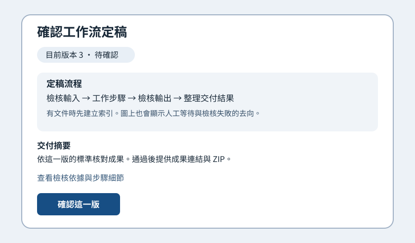

# 規格整理 v 1.2.0

## 非技術規格文件

**RoutineKeel 工作流如何定稿、檢查與交付**

### 先定義工作，再確認流程

在 Studio 說明你要完成的任務、要提供的資料和想拿到的成果。初稿會先列出這項工作自己的步驟。你可以修正順序、分支、檢查方法和需要人工看過的地方。下次開啟同一個專案，可以從已保存的進度繼續。

定稿時，流程圖會加上底座的三個固定步驟。你能在同一處核對完整流程和交付標準。確認只適用於畫面上的這一版。定稿後，底座會先在臨時工作區試跑候選套件，通過才進入正式安裝。

| 步驟 | 你會看到什麼 |
| --- | --- |
| 檢核輸入 | 核對必須提供的資料、格式及檔案。資料不齊時指出需要補哪些內容。 |
| 檢核輸出 | 檢查各項成果是否齊全，是否符合你確認的標準。若需要人審，流程會停在指定位置等待回覆。 |
| 整理交付結果 | 把合格成果保存成可追溯的版本，提供各項成果的連結和一份可下載的 ZIP。 |

### 工作中可加上的檢查

- **數據勾稽**適用於有兩邊資料可互相驗證的工作。例如把交易明細加總後核對月報，或按單號找出金額不同、只出現在一邊的紀錄。第一次確認比對規則，後續沿用同一份計畫，每次都比較當次資料。
- **文件查詢**適用於 PDF、Word、Excel、PowerPoint 等指定文件。底座會用 Documa 讀取文件並建立內容索引。你可以查詢相關段落，從區塊及圖中的關係定位來源。附件匯入後可以先看可提供的預覽。圖或媒體若需縮放，會保留原比例。
- **技能載入**由 Documa 從受信的技能目錄載入任務所需的指引與相依技能。無法確定要採用哪個技能時，畫面會顯示原因與可供選擇的項目。
- **模型審查與回修**可依你確認的標準評估成果。批評者會列出問題，修訂者只在有待修項時處理。可立即顯示的文字會隨產生逐段出現。你可以在流程指定要驗收修訂結果的時機與最多可重做的次數。

### 定稿審閱的呈現

畫面沿用你所在的桌面對話。示意圖用白底、淡灰區塊與深色文字，藍色標出這一階段的主要動作。先看工作流程、目前狀態與需要確認的內容。勾稽明細、文件來源及歷史紀錄可在需要查證時展開。

### 常見提示與接續方式

| 你看到的提示 | 可以如何接續 |
| --- | --- |
| 請核對輸入欄位與檔案後重試 | 補上必填資料或換成可讀取的檔案。 |
| 文件處理暫停 | 查看 Documa 回報的原因。來源或環境補齊後，可重試原步驟。 |
| 已找到差異 | 展開勾稽報告。依原先約定選擇補件、修正或進入人工校閱。 |
| 請核對目前版本後重新確認 | 定稿有變動時，打開新的流程圖，確認新的內容。 |
| 正式交付暫緩 | 查看保留的預覽、檢查結果與接續方式。先前已正式交付的成果仍可查詢。 |
| 本次成果已交付 | 開啟個別成果，或下載 ZIP 取得本次的具名成果。 |

可用性取決於當地提供的文件讀取工具、已核定的模型與工作流規則。需要核准、付費或將資料送出本機時，仍由你按畫面所列內容確認。
