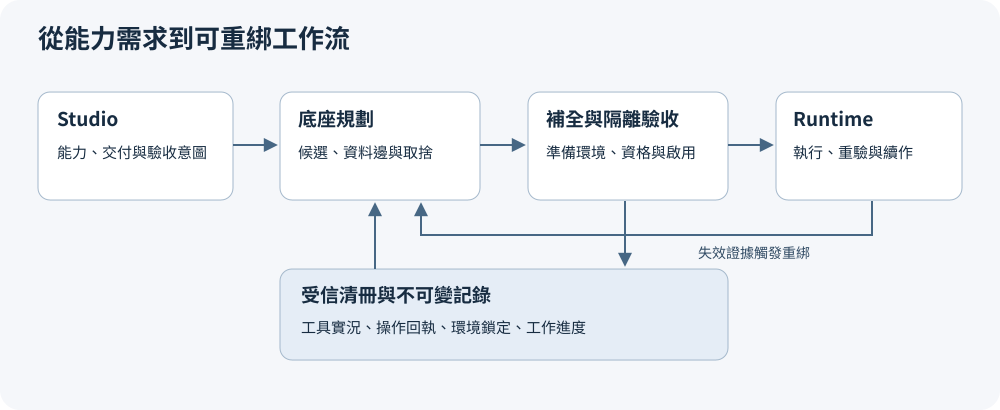

# 規格整理 v 1.2.0

## 技術規格文件

**RoutineKeel 通用工具鏈補全** · 2026-11-25 · 基線 `main c9c92b8`

### 背景、目標與範圍

現有底座能保存缺口、驗證已登錄的 Adapter，再接續候選建置、隔離試做及安裝。抽象可攜需求主要來自 Pattern，一般節點依已宣告的能力與版本解析。本規格將兩者接上共用需求模型，增加逐候選診斷、多工具規劃、環境與 Adapter 補全、獨立驗收，以及 Runtime 失效後的自動重綁。 [現有補強規格](../blueprint-completion.md) · [Pack 與資格契約](../domain-packs.md)

任何受支援的藍圖能力需求都能取得可追查的處理結果。底座產生合格方案、可執行待辦或具體等待條件。遇到無實作、無授權、無硬體或搜尋尚未取得方案時，保存其他有效進度。沿用 Python、uv、SQLite、FileLock、本機無常駐服務，以及桌面對話、CLI 和 MCP stdio。實際部署、配置和外部副作用各依授權範圍執行。

**方向確認。** 2026-11-25 確認等效替換通過重驗後，在同一工作建立續做 Run 並連回原 Run。工作識別碼延續，原 Run 的執行圖、綁定、成果與收據保留。此功能的開發範圍是底座、Studio 契約及宿主介接。正式發布及私人環境切換依原交付流程另行授權。

| 角色或衡量項目 | 規格 |
| --- | --- |
| 設計者 | 在 Studio 確認業務語意、必要測例、限制與可替換政策。 |
| 操作者 | 查看正在補強的內容，在缺件、實質取捨或需授權時提供最小必要回覆。 |
| 維護者／QA | 維護實作、受信來源、準備配方和資格案例，重跑安裝、重綁及回退證據。 |
| 宿主 | 提供真實工具觀測、可核對的工具鏈及 Adapter 提案、工具回執和使用者實際答覆。持有憑證並按核准範圍派送。 |
| Goal | 一份起初沒有單一合格工具的藍圖，可由底座實際組合、補全、驗證、安裝並執行。 |
| Methods | 底座以具型別和語意的資料邊規劃，用可追查配方補全，以不可變收據發行及重綁。 |
| Metrics | 每個已評估候選可追查結論。同一操作重送的額外副作用為零。缺必要驗證的安裝成功數為零。兩種不同領域各實跑一條多工具鏈，另驗證失效重綁及回退。 |
| Milestones | 打通通用需求、候選及規劃，再交付環境與 Adapter 補全、重綁，最後驗收可安裝候選。 |

### 模組責任與專案目錄

| 目錄 | 責任及代表入口 |
| --- | --- |
| `flow_base/components/workflow_contracts/` | 共用能力、觀測、工具鏈、配方、資格及鎖定契約。Studio、Builder、Runtime 使用相同規則。 |
| `flow_base/src/flow_base/graph/` | 延伸 `portable`、`capabilities`、`qualification`、`builder` 和 Runtime 排程。新增多工具規劃及穩定編譯。 |
| `flow_base/src/flow_base/blueprints/` | 延伸 `completion`、`completion_store` 與 `installer`，負責補全、隔離試做、核准、啟用和回退。 |
| `flow_base/src/flow_base/adapters/`、`capability_packs/` | 受信探測與宿主回執的共用介面，及個別領域的能力、實作、套件配方和測例。 |
| `workflow_studio/src/workflow_studio/conversation/` | 定義抽象需求與驗收意圖，展示候選差異，保存使用者回覆及原版次。 |
| `tests/`、`tests/studio/`、`tests/e2e/` | 契約和庫存測試、Studio 相容性、跨領域及封裝驗收。使用受控素材。 |

公開資料使用具名能力、穩定步驟路徑、具名資料埠及完整 SHA-256。設定與策略沿用底座和領域套件責任邊界。驗收說明與可重跑紀錄放於本目錄。

### 1. 通用需求、觀測與診斷

- **需求入口。** Graph v2 增加可版本化的節點需求，以穩定節點路徑索引。一般節點、Pattern 及巢狀節點使用同一模型。包含能力 ID、版本範圍、輸入輸出語意、必要驗收、固定／可替換政策、可選交付、授權範圍、位置、時限和預算。原節點未宣告替代需求時沿用指定能力與版本。保留 Pattern 的來源。重疊要求須一致，衝突須指出路徑與來源。v1 以既有配方進入缺口介面，採用抽象替換須先透過 Studio 確認 Graph 修訂。
- **觀測格式。** 內建、Python entry point、本機程式、MCP、宿主代理的 API／模型及人工作業均用同一描述。含版本、平台、環境、能力與埠、權限、副作用、資料去向、費用證據、來源、觀測時間及有效期。分別記錄註冊、安裝、可呼叫、有授權和資格通過。外部工具由宿主提供實際觀測。人工作業保留具名待辦與實際回覆。
- **候選發現。** 底座查詢已連結的受信清冊與可用套件索引，可找到尚未安裝的候選。需要新來源時，宿主可提議來源或套件。提議列為待核對，保存查詢範圍、來源證據及取得所需權限。經來源政策核對後重新觀測，再進依賴補全或資格驗證。
- **缺口與淘汰理由。** 保存需求 ID、步驟和資料邊、影響範圍、候選及逐項理由、證據、下一動作、負責者及解除條件。辨識缺套件、逾期、型別或單位不符、去向不允許、權限不足、案例或預算不足。預檢接入既有補強工作。可安全完成的獨立工作先做，待決內容保存於相同識別碼。

候選分為待觀測、待準備、待核准、待驗證、合格或淘汰。工具身分由受信實作來源、服務或套件識別及工具 ID 組成。工具同名時各自保留觀測和授權。`NO_CANDIDATE` 只表示本次查詢範圍內無可用候選。搜尋提前中止時回傳 `SEARCH_LIMIT_REACHED`、已搜尋的來源及可續行識別。已檢查候選的診斷包含理由碼、比對欄位、期望與實測摘要。涉及敏感資料時僅回傳可揭露的摘要或證據引用。

### 2. 多工具規劃與可驗證編譯

規劃器從必要交付向上找可滿足前置的實作，建立帶型別、語意和作用範圍的有向子圖。支援串接、分支匯合、共用前置成果、明示轉換及驗證節點。主藍圖原有的分支、人工點與迭代邊界繼續生效。

1. 每條資料邊核對名稱、型別、資料語意、單位、精度、必要欄位與目的地。必要輸入須有獲准來源。欄位名稱相似不足以建立語意對應。允許的損失及誤差須由契約或已核准規則提供。
2. 合併整鏈權限、資料去向、相依版本、成本上限、關鍵路徑延遲、資源峰值與可重試性。費用包含最壞可達分支及允許的試做、迭代與重試次數。併行節點的資源按可能重疊的峰值檢查。未知成本、未知權限或缺證據列為待判定。每項整鏈硬限制通過後才可選用。
3. 以版本化政策控制最大展開狀態、鏈長、組合數及看門狗時間。相同輸入、快照、政策和展開上限應得到可重算的候選及淘汰理由。先套用硬限制，再按已確認偏好排序。無偏好時依既有授權、可復原性、成本及穩定 ID 排序。上限耗盡保存搜尋範圍、已評估候選及待展開狀態。繼續相同搜尋須核對需求、快照及政策，任何一項變更則建立新版搜尋。
4. 宿主可提出候選鏈、映射、測例或 Adapter。底座重新建圖、檢查和判定。唯一或可由已確認規則決定的等效低風險方案可進補全。費用、資料去向、品質或業務差異有實質取捨時，保存使用者對具體差異的選擇。改變必要交付或業務語意時由 Studio 建立新藍圖版本。
5. Builder 將合格方案編譯為具名執行子圖，穩定分配執行 ID。保留原節點、展開步驟、資料邊、轉換及驗收依據的對照。鎖定與候選收據均包含最後展開圖的指紋。

### 3. 運用配方補全環境與建立 Adapter

| 情形 | 自動或受控執行 |
| --- | --- |
| 已登錄且有實作 | 核對來源、平台、版本、完整性及授權。相同範圍的有效資格可重用，其他安全候選進試做。 |
| 缺套件或本機程式 | 依受信配方鎖定版本、平台和傳遞依賴指紋，在隔離環境實際準備並重新探測。配方宣告前置、可執行型別動作、驗證、用量、補償與失敗去向。 |
| 缺宿主服務配置 | 執行受信的具名配置動作。需要授權時呈現目的地、成本、作用範圍及回復條件。使用宿主回執驗證配置，再刷新觀測。 |
| 缺 Adapter | 受支援的具型別資料轉換，由底座把映射、已登錄工具及白名單轉換實際編譯成可登錄產物。需要通用程式時，宿主可供應來源、契約與測例，由受控建置、審查和隔離驗證產生具版本候選。兩種產物皆經實際案例驗證後才登錄及採用。 |

**安全邊界。** 配方動作須經解析、型別檢查、可信來源政策與具體授權。執行外來或新生成程式時，以平台隔離或受信隔離執行器限制檔案、程序、網路及資源。隔離證據不足時保留待驗證。機密由宿主或既有憑證邊界提供，日誌保存範圍、識別與指紋。已有依賴以完整的版本及校驗值為準，取得相依資料或載入候選前核對來源信任。

配方的執行順序為「核對來源與授權 → 準備指定依賴 → 探測實作 → 跑資格案例 → 寫入證據」。Python 路徑沿用 uv 與鎖定依賴，系統工具由版本化的指定執行器準備。外來程式的驗收以實測限制為準，暫存目錄與 Python 虛擬環境僅提供檔案佈局和依賴隔離。程式候選須在可約束程序、檔案、網路與資源的執行器內試做。宿主需透過授權設定及驗證動作提供服務可用證據。缺這兩類執行條件時，待辦須指向具體平台、執行器或服務設定。

**交易與復原。** 保存計畫、操作 ID 與授權後執行。安裝、配置、試做及啟用各有完成證據。外送、付費、權限提升或正式環境變更的核准綁定實際內容、對象、資料去向、上限、版本及有效期。回應逾時或程序中斷時先查核原操作 ID。補償動作需有具體範圍及適用授權。候選通過後才以原子切換啟用，保留前版和回復入口。

### 4. 分層資格、證據與放行

| 關卡 | 必備證據 |
| --- | --- |
| 靜態相容與準備性 | 能力、型別、語意、資料去向、權限、相依及用量符合要求。 |
| 介面與行為 | 檢查實際版本、參數映射、輸出、錯誤行為、逾時、副作用和資源。用獨立預期值跑正例、反例及邊界。 |
| 整鏈驗證 | 驗證中間格式、合併與分支、失敗行為、保真條件及最終交付。 |
| 候選驗收 | 以實際候選套件在臨時工作區實跑已確認的必要案例與補強案例，保存分段產物與觀測。 |
| 啟用前重驗 | 核對有效執行圖、版本與綁定全鏈、依賴與權限、環境、IR、wheel RECORD、候選及試做收據。必要結果均須為 `PASS`。 |

原驗收意圖與品質下限隨藍圖保存。可補充有來源的例子。預期值由已核准規則、獨立參考實作、已驗證資料或使用者確認形成。測具回執與正式可用的工具觀測明確標示。可重用收據須匹配案例、實作、環境、範圍與政策。環境有變化時重驗受影響的部分並再次通過整體放行。

Builder 從已確認的藍圖與測例修訂取得驗收指紋，再接收候選實作。宿主提案只能引用既有驗收指紋或提出待確認的新案例。候選執行程序只能提交實際結果，試做端使用原指紋對應的預期值評分。案例、流程語意或品質下限改版時，建立新驗收修訂並重新進入驗證。缺少可獨立核對的預期值時回報 `NOT_RUN` 與補件方式。

### 5. Runtime 失效重綁與續作

1. **偵測。** 在開始、恢復、領取宿主任務及處理能力錯誤時核對版本、指紋、權限、有效期及實際狀態。區分暫時斷線、授權不足、相依變動、結果不明及行為失效。
2. **建立補強工作。** 暫停受影響步驟的派送，依工作 ID、來源 Run、失效綁定與穩定失效指紋建立具名重綁任務。相同失效重送共用同一任務。收到同一 Run 的其他失效時併入待處理範圍，啟用前重新核對所有受影響路徑。存在未確定的外部動作時，用原操作 ID 查證。影響範圍外的步驟可在舊 Run 落下完成檢查點，再進入續作交接。
3. **重驗與換綁。** 原工具恢復且仍是原鎖定綁定，重驗通過後可於原 Run 接續。替代工具或環境指紋改變時，使用新觀測走共用規劃、補全、資格與核准路徑。等效綁定須符合已確認的替換政策及原授權範圍。新的費用、資料去向、權限或業務契約差異須取得適用核准。業務契約變更走既有藍圖演進。
4. **新版啟用。** 新等效綁定產生不可變的啟用修訂，綁定執行圖、候選與試做收據。若原包的執行計畫固定在 wheel 內，走既有更新程序。交接須核對來源 Run 的最終檢查點、未結束的派送、預期啟用版次及授權。先保存交接意圖，再以一次可重送的原子狀態轉移記錄來源 Run、續做 Run 和新綁定。共享安裝的版本切換依原更新授權另行處理。
5. **安全續作。** 在同一工作下建立續做 Run，記錄 `parent_run_id`、重綁工作 ID、舊／新綁定和繼承的產物引用。同一交接只允許一個續做 Run 取得派送權。只重用內容指紋、有效輸入、節點語意、產生者、上游證據和適用權限均可核對的成果。由改變的資料邊、控制邊與有界子流程計算受影響後代並重新執行。已查證發生的外部操作保存原收據，結果未知的操作維持待核對。回退會保留前後 Run 和已發生的操作，後續派送須重新檢查回退目標的資格與權限。

### 資料、持久化及公開入口

| 物件 | 欄位與生命週期 |
| --- | --- |
| 能力需求與實作描述 | 需求 ID、節點、語意、版本、來源與範圍。修訂建新版本，停用或封存保留引用。 |
| 觀測與診斷 | 環境、指紋、有效期、候選及逐項理由。刷新新增快照，舊證據依保留政策封存。 |
| 工具鏈、補全與核准 | 原需求對照、埠與拓撲、依賴、配方、權限、回復方式、授權指紋和操作回執。變更建新修訂，支援暫停、取消及封存。 |
| 資格與啟用收據 | 藍圖、候選、依賴、案例、工具、環境、權限及政策指紋。收據不可變，指標版本化。 |
| 重綁工作與 Run | 舊綁定／Run、失效證據、受影響路徑、新綁定／Run、重用產物及待查回執。支援續做與查閱歷史。 |

重用 SQLite、FileLock 和既有產物儲存。變更含 `request_id`、`expected_revision` 與操作 ID。相同內容重送返回已保存結果，版次衝突返回目前狀態。先保存執行意圖，再接受完成回執。重啟時審核租約與已完成動作。資料升級必須先備份並實測可還原。舊 v1、Graph v2、已安裝包、Run、Artifact 與公開入口各有相容回歸。

- **入口。** 延伸 `blueprint_completion` 的 `start`、`status`、`history`、`recheck`、`submit`、`advance`。新增具型別的方案比較、補全核准與目標選擇，CLI、MCP 和宿主共用契約。保持舊操作欄位。唯讀查詢取用淘汰明細及驗證證據。
- **背景。** 使用現有本機工作程序，保存排入、處理、等待、驗證、失敗及取消。探測、規劃、安裝、試做及重綁均有時限、重試條件、租約與可恢復狀態。續作只在有效事件、操作授權或觀測更新時接續。
- **觀測。** 記錄觀測時間、候選淘汰、方案選定、操作開始／完成、回執待查、資格、啟用及重綁。附工作、方案、節點、操作、Run 和證據 ID。用以統計搜尋展開、合格率、人工介入、用量與恢復時間。日誌只保留適合公開給該操作者的摘要或引用。

#### 操作及相容契約

| 操作 | 請求與回覆 |
| --- | --- |
| 開始補強 | 沿用既有 `start` 請求，回覆 `work_id`、`revision`、`status`。採用可攜需求時附本次 `observation_id` 及 `planning_phase`。 |
| 檢查狀態與歷史 | `status` 與 `history` 為唯讀。狀態帶可執行缺口、方案摘要、目前驗證階段和最新事件。候選明細依 `work_id`、`observation_id` 和 `candidate_id` 查詢，支援分頁。 |
| 提交選擇或核准 | `submit` 校驗 `request_id`、`expected_revision`、`gap_id`、`scope_hash` 及具體 `action`。選擇方案附 `plan_id`。需人審時，保存使用者實際答覆及授權紀錄。快照、目標、費用或情境變動時，刷新範圍後才可重送。 |
| 往下做或重驗 | `advance` 使用仍有效的快照及收據。`recheck` 刷新相關觀測，舊證據仍可查閱。未知外部結果先依 `operation_id` 查證。作業狀態及錯誤皆帶可執行下一步或明確等待條件。 |
| 查詢 Runtime 續作 | 原工作仍可透過既有 `execution_id` 或 `blueprint_task` 工作階段查詢。新增 `root_run_id`、`active_run_id`、`rebind_work_id` 及等待原因。`get_run_status` 依指定 Run 查其原始歷史。結果中 `run_id` 指向交付該批 `artifacts` 的 Run。未發生重綁時，原欄位及結果語意維持相容。 |

#### 持久狀態與回復條件

| 物件 | 主要轉移與保留規則 |
| --- | --- |
| 觀測 | 已記錄 → 有效／待核對 → 過期或撤回。觀測事實以新快照修訂，有查驗引用的紀錄可封存。 |
| 方案 | 搜尋中 → 已提案 → 待準備／待資格 → 合格／淘汰。輸入或觀測變動時使舊方案失效，若已選用可追查其替代版本。 |
| 補全操作 | 已記錄意圖 → 待授權／已排入 → 執行中 → 已確認／回執待查／失敗。已確認或已撤回後可封存。程序重啟時先核對租約、操作 ID 與實際回執。 |
| 啟用與續作 | 待重驗 → 可啟用 → 臨界交接 → 已啟用。取消或重驗失敗退回待處理。提交後失聯時，以已寫入的啟用版次與 Run 關聯恢復。每個前版保留回退紀錄。 |

取消只終止尚可停止的操作。已知完成的外部動作沿用既有回執，需要撤銷時另行評估可行補償及其授權。依現有工作資料保留政策清理無引用的隔離暫存。已交付 Run、有效鎖定與收據引用保留，使用者可封存工作並另開新工作。

### 對話與 CLI 的任務模型

主目標是完成目前工作的工具準備或安全續作。次目標是確認實質取捨及必要授權。低頻查詢包括候選淘汰、版本比較及歷史。例外操作包括回執待查、取消與回退。沿用既有宿主對話和純文字 CLI，語氣直接說明已完成項目及下一步。示意圖以淺灰為背景、深藍文字呈現狀態，單一藍色操作用於目前需確認的事項。CLI 的狀態及阻礙有文字提示。 [審閱版面示意](review-layout.svg)

### 狀態、資訊分類與揭露

| 狀態 | 當下必顯 | 主操作及離開條件 | 延後顯示 |
| --- | --- | --- | --- |
| 診斷／規劃 | 工作名稱、已解及未解數、實際進度 | 底座繼續。找到合格方案或有具體阻礙時轉入對應狀態。 | 淘汰明細依查詢展開。 |
| 等補件、選擇或授權 | 待辦、受影響交付、費用及去向 | 一次回答足以影響當次行動的項目。取得有效回覆即重驗。 | 其他方案與完整來源供檢視。 |
| 補全或試做 | 完成動作、正在跑的實際案例 | 可以查進度。成功後交付，失敗回到相應缺口。 | 原始日誌依錯誤狀態或查詢顯示。 |
| 失效／待重綁 | 失效步驟、已保留成果、待查外部操作 | 核對具體阻礙。新方案重驗、授權及啟用後接續。 | 版本比較、舊工作與回退資料供查閱。 |
| 已驗證／已啟用 | 可取得的候選或成果、版本與驗收結果 | 依原請求交付。可以查收據或原工作。 | 日誌和逐案證據供查閱。 |

| 資訊項目 | 分類與頻率 | 顯示條件與位置 |
| --- | --- | --- |
| 工作進度、目前阻礙、已完成摘要 | `status-feedback`、`action-critical`，高頻 | `must-see-now`。狀態摘要旁顯示目前唯一主要操作。 |
| 候選差異、費用、權限及資料去向 | `decision-supporting`，有取捨時 | `next-step-only`。進入待決狀態時在確認項下展開，唯讀查詢可檢視其餘方案。 |
| 回執待查與補償／回退 | `exception-handling`，低頻 | `error-only`。在外部操作不明或恢復失敗時，以行內提示顯示查核入口及當前限制。 |
| 淘汰明細、鎖定、逐案證據、Run 關聯 | `reference`、`audit-history`，低頻 | `on-demand-reference`。預設收合以保留操作空間，透過詳情或 CLI 唯讀查詢揭露。 |
| 機密、完整私人素材與未遮罩參數 | 受保護資訊 | `keep-off-first-viewport`。在對話、狀態及一般日誌使用遮罩摘要或具權限的本機引用。 |

`status` 回覆主摘要，唯讀查詢回覆方案與證據，`submit` 保存具體決定或拒絕。事件記錄顯示過的待辦版次、操作者動作、授權結果與恢復點。用同一工作 ID 恢復，新的工作由明確 `start` 取得。開啟新的工作仍可回查舊工作紀錄。

附件和測試素材先提供預覽或格式、大小及指紋資訊，圖片和影片維持比例。模型產生的可見文字採增量串流。進度與用量從底座事件來，宿主重連依已保存狀態恢復頁面。

### 驗收、邊界與放行

| ID | 情境 | 通過條件 |
| --- | --- | --- |
| A1 | 一般節點與 Pattern 巢狀節點各缺能力 | 同一入口產生具名需求及診斷。取得工具後重做相關部分。v1 及舊版 Graph v2 保留入口與語意。 |
| A2 | 報表領域只有 CSV 讀取、小數正規化和逐鍵勾稽三種工具 | 底座規劃三步、說明被拒方案、依配方實際補套件，隔離試做後安裝、執行及產生具名交付。 |
| A3 | 文件流程需要 Documa 解析、格式轉換、來源引用交付，清冊缺少轉換實作 | 底座規劃完整工具鏈，在隔離環境實際生成並登錄具型別的轉換 Adapter。用獨立預期值驗證引用、順序、缺頁，並試做安裝後的完整文件成果。 |
| A4 | 權限、套件、成本、去向、型別或搜尋上限出現缺口 | 每個已評估的淘汰候選有可查理由和續作條件。等待或拒絕授權期間，其他獨立項目可完成。 |
| A5 | 補全中斷、重送、雙程序搶占及版本漂移 | 相同操作沒有額外副作用。部分變更隔離或回復。舊收據失效後能刷新環境並續作。 |
| A6 | Runtime 執行中，模型權限過期或本機工具改版 | 重送只建立一次重綁工作。相同綁定恢復後重驗並續跑原 Run。換綁時只建立一個相同工作 ID 的續做 Run，保留可驗證的成果與原 Run 歷史，重新執行受影響後代。 |
| A7 | 外傳結果不明、費用提高、套件遭竄改及回退 | 查核原操作，危險差異取得新核准，缺證據維持未放行。回退後能以舊版和原證據執行。 |
| A8 | 從發行候選在隔離環境驗收 | Windows／Linux 重播 CLI、真實 MCP stdio、Studio、已安裝工作流與回滾。備份能實際還原。其他平台和真實付費服務依取得的實測另列。 |
| A9 | 同一工作遭遇「無單一能力」及「執行時失效」 | 測具清冊只供應分離工具，無預登錄整鏈。底座實際規劃、準備缺失依賴或 Adapter，通過候選驗收及安裝。注入失效後，Runtime 自動啟動重綁、新方案通過驗證，續做 Run 交付有獨立預期值的成果。證據從原需求可一路對應到兩次有效綁定、試做收據與最終 Run。 |
| A10 | 宿主工具已連線，服務仍欠缺已授權的設定 | 在隔離測試服務執行具名配置，重新探測並實際跑案例。於取得配置結果前切斷回覆，重啟後查證同一操作 ID，服務設定僅寫入一次。 |
| A11 | 需要程式 Adapter，宿主提供來源與提案 | 以受控執行器實際建置、隔離試做及登錄具版本產物。用獨立案例驗證參數與錯誤回傳。隔離無法證明、候選改動預期值或建置後產物遭變更時，必須留在缺口或試做失敗狀態。 |

**A9 的可重播案例。** 使用兩份包含小數金額的 CSV，清冊只有讀取、正規化與逐鍵比對三個工具，其中正規化依賴尚未安裝。已確認案例期望 `K01` 相符、`K02` 的差額為 `0.10`、`K03` 僅出現在右表。先完成實際補全、試做與安裝，再於正式 Run 保存讀取成果後移除原正規化工具。測具只提供符合原契約和授權的替代項。工作重驗並續跑後，逐項檢查差異清單、讀取成果的原指紋、唯一續做 Run、兩次綁定和兩份試做收據。重播同一失效事件，續做 Run 和派送次數維持不變。

補驗未登錄能力、假版本、資料單位錯配、爆量候選、循環依賴、配額耗盡、並行回退及工具回覆夾帶操作指令。固定清冊測量搜尋展開數、診斷期限、同範圍規劃一致性與檢查點恢復耗時。必要測試以版本化政策設定門檻，失敗提供可重現證據。

重綁的必要故障點包含保存交接意圖後、寫入續做 Run 關聯後、續做程序開始派送前。各點中斷後重啟，核對原成果內容與來源、續做 Run 唯一性、外部操作次數，以及 CLI／MCP 查到的 Run 關聯。若仍無合格替代工具，保留原 Run 與可追查的阻礙。所有關卡以實際測試、收據與資料還原證據判定。可重跑的搜尋與恢復門檻由 Stage 0 用固定清冊在各測試平台記錄，後續變更以同一清冊對照。

### 研究參照

2026-11-25 查核。MCP 提供當前授權範圍內的工具觀測，資格判定另外比對藍圖測例。CWL 與 cwltool 提供具名資料邊、匯合及子流程的設計參考。 [MCP 工具規範](https://github.com/modelcontextprotocol/modelcontextprotocol/blob/main/docs/specification/2026-07-28/server/tools.mdx) · [CWL Workflow 定義](https://www.commonwl.org/v1.2/Workflow.html) · [cwltool](https://github.com/common-workflow-language/cwltool)

Terraform provider 依賴鎖定提供版本與校驗值的比較基準。Python 依賴仍採用 RoutineKeel 現有的 uv 鎖定流程。Temporal 的 Worker 版本鎖定提供執行歷史保全的參考。RoutineKeel 依本案決定用同一工作下的 Run 關聯承接等效換綁。 [Terraform 依賴鎖定](https://developer.hashicorp.com/terraform/language/files/dependency-lock) · [uv 鎖定與同步](https://docs.astral.sh/uv/concepts/projects/sync/) · [Temporal Worker Versioning](https://docs.temporal.io/best-practices/worker#use-worker-versioning-to-safely-deploy-new-workflow-code)
