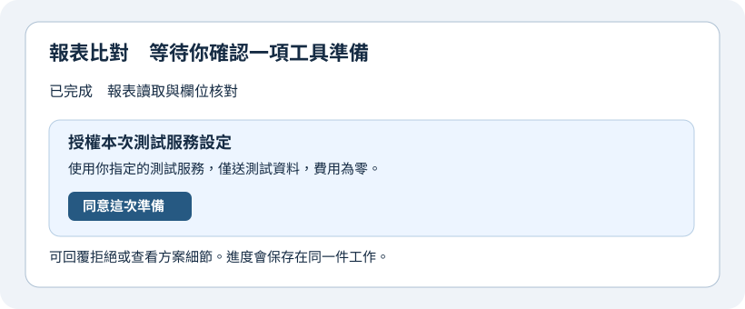

# 規格整理 v 1.2.0

## 非技術規格文件

**RoutineKeel 通用工具鏈補全** · 給設計、使用及校閱工作流的人

### 交付方式

你提供想得到的成果、可使用的資料與必要規則。RoutineKeel 會找出可用的工具。如果單一工具做不完，它會安排數個工具分工，再檢查每一步交出去的資料能否被下一步正確使用。它會實際準備可授權的工具、補上支援的轉接方式，並用已確認的範例試跑。

例如，你要比對兩份報表的案號與金額。RoutineKeel 可以安排讀取報表、將金額整理成可精確比較的形式，再逐筆比對。你會看到哪些資料已準備好，哪些情況已試過，以及最後交付的差異清單。

### 你會看到什麼

沿用原有的對話和命令列。先顯示目前進度，再顯示你現在要處理的事及已完成成果。狀態會用文字標明，顏色只用來幫助辨認。

| 提示 | 你可以怎麼做 |
| --- | --- |
| 「找到可用的工具，正在核對三步能否接起來。」 | 等待或查詢進度。可先做的工作會自行處理。 |
| 「這個方案需要把不含個人資料的測試檔交給你指定的服務。」 | 查看傳送範圍、費用和替代選項，再同意或拒絕。 |
| 「還缺一份你確認過的正確結果。」 | 確認預覽後補上範例。先前完成的準備會保留。 |
| 「工具已失效。已保存讀取結果，正在查找替代工具。」 | 用同一工作編號查看結果。有新取捨時依提示決定。 |
| 「已提出外部請求，正在查核結果。」 | 等原請求查清楚再繼續。可查看已取得的回覆。 |
| 「試跑已通過，工作流可安裝。」 | 查看確認過的版本、案例和候選位置。若已要求安裝，會看到實際安裝結果。 |

### 可以接續，也可以回復

你可以關掉對話，之後用同一工作編號繼續。單一項目需要素材或決定時，其他能先做的項目會繼續。若工具最後仍無法取得，畫面會說清楚缺什麼、誰可以提供，以及哪些準備已完成。

如果執行途中工具改版或權限到期，RoutineKeel 會先停下受影響的步驟，再核對原工具或準備替代方案。原工具恢復並通過檢查時，可接著原來的執行紀錄繼續。換用等效工具並通過試跑後，RoutineKeel 會在同一工作編號下建立一筆續做紀錄，保留與原紀錄的連結，沿用經核對仍可使用的成果。當替代方案會改變費用、資料去向、權限或交付方式時，你會先看到具體差異。

如果先前已向外部服務提出請求，但當時收不到回覆，RoutineKeel 會先查原請求的結果。你可以查看已完成的操作與仍待確認的部分。舊版、以前交付的成果，以及符合回復條件的版本都可在工作歷史中查閱。

### 完成後會取得什麼

你會取得試跑過的工作流、測過的案例、使用的工具版本及查看成果的位置。完成安裝的工作會顯示安裝版本。若有待處理的限制，清單會保留可以做到的部分及下一個必要行動。

補交測試材料時，會先呈現預覽。格式暫時無法預覽時，會說明並顯示檔名、格式及大小，方便你確認選到的檔案。圖片與影片維持原比例。需要產生文字解釋時，文字會邊產生邊出現在對話中。
